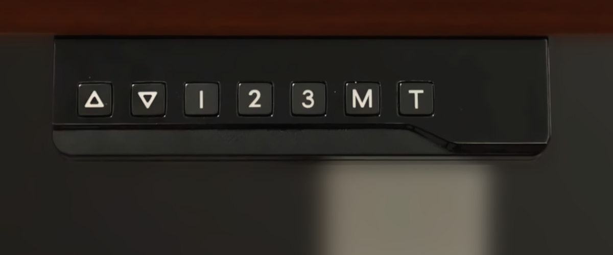

# T150 Desk Control

T150 Desk Control adds ESPHome, browser and Home Assistant control to compatible T150 standing desks. An ESP32 talks to the desk controller over UART. Optional patches extend and fix the original controller firmware.

Developed on a Deltaco Gaming DT410. See [hardware and compatibility](docs/hardware.md) for controller markings, related models and wiring.



## Features

Every control is available in ESPHome, the browser and Home Assistant. Hardware results apply to the DT410; see [supported features and testing](docs/validation.md) for what has been checked.

### With the original controller firmware

| Feature                   | Notes                                                                                                       |
| ------------------------- | ----------------------------------------------------------------------------------------------------------- |
| Height                    | In [cm or inches](docs/esphome.md#display-units), with UART connection status                               |
| Presets                   | Recall and edit presets 1 to 3                                                                              |
| Target height             | Borrows preset 3 for the move, then restores it. See the [preset backend](docs/esphome.md#preset-backend)   |
| Stop                      | Soft deceleration, not an emergency stop. See [what Stop does](docs/esphome.md#what-stop-does)              |
| Keep-awake                | Optional. A periodic preset-3 workaround keeps the UART awake. See [keep-awake](docs/esphome.md#keep-awake) |
| Panel timers              | Optional. Emulates T-key presses for the panel's own durations. See [timers](docs/esphome.md#timers)        |
| Load telemetry and limits | Optional. Raw, uncalibrated values. See [load settings](docs/esphome.md#optional-load-settings)             |
| Firmware backup           | Separate read-only build. See the [firmware reader](docs/firmware-export.md)                                |

### With the patched controller firmware

[Firmware maintenance](docs/firmware-update.md) backs up the original firmware, installs the patched version and can restore the backup. The current patched firmware includes everything below.

| Feature                      | Notes                                                                                                                           |
| ---------------------------- | ------------------------------------------------------------------------------------------------------------------------------- |
| Direct target height         | Moves to a height without changing saved presets. See the [direct backend](docs/esphome.md#direct-backend)                      |
| Panel lock                   | Lock, unlock and stop from the panel with M + T. The lock survives power loss. See [panel lock](docs/panel-lock.md)             |
| Calibration and motion speed | Guarded calibration and a Normal/Slow speed choice. See [reset and motion speed](docs/reset-speed.md)                           |
| Motion trims                 | Stopping adjustment for each speed and direction. See [motion trims](docs/motion-trims.md)                                      |
| Custom timer and buzzer      | Timer of 2 to 720 minutes, volume, short pulses and a separate alarm sound. See [timer and buzzer](docs/custom-timer-buzzer.md) |
| Display timeout              | Blanks the idle height digits after a set time. See [display timeout](docs/display.md)                                          |
| Sleep fix                    | Keeps telemetry running across the RTC hour boundary. See [firmware fixes](docs/validation.md#controller-firmware-fixes)        |
| UART receive fix             | Stops split or merged commands in the receive parser. See [firmware fixes](docs/validation.md#controller-firmware-fixes)        |

For related desks, see [untested compatibility candidates and how to contribute firmware](docs/hardware.md#possible-compatibility-untested).

## Install

The GitHub examples follow development sources on `main`. Set `t150_ref` to a
commit or release tag to keep builds on that version.
See [release preparation](docs/releases.md) for versioning and validation.

You need a compatible controller, a Wi-Fi ESP32 and three UART wires. [Connect TX, RX and ground](docs/hardware.md#uart-wiring); power the ESP32 separately through USB.

| Board                  | Configuration                                          | ESP32 TX / RX   | Coverage        |
| ---------------------- | ------------------------------------------------------ | --------------- | --------------- |
| M5Stack Stamp-C3, 4 MB | [stamp-c3.yaml](examples/esphome/github/stamp-c3.yaml) | GPIO4 / GPIO5   | Hardware tested |
| ESP32-WROOM-32, 4 MB   | [esp32.yaml](examples/esphome/github/esp32.yaml)       | GPIO17 / GPIO16 | Build tested    |

For an existing ESPHome device, merge [existing-device.yaml](examples/esphome/existing-device.yaml)
into your configuration and keep your network, API and OTA settings.
See [existing devices](docs/esphome.md#existing-device).

### Ready-made Stamp-C3 image

For a published factory image, follow [USB installation](docs/binary-install.md).
ESPHome Web configures Wi-Fi, and the Stamp generates its web password and
Home Assistant key. This path needs no local compiler or YAML edits. Use the
YAML path below for OTA, firmware maintenance and optional controller controls.

### ESPHome Device Builder

1. Create a device and replace its YAML with the board configuration above. It downloads its packages and components from GitHub.
2. Set `device_name`, keeping the existing name when updating a device. Add the keys from [secrets.example.yaml](examples/esphome/secrets.example.yaml) to Device Builder's `secrets.yaml`, beside the device YAML. Fill in your credentials; retain the wizard's API encryption key or generate one with `openssl rand -base64 32`.
3. Validate and install over USB. Later ESP32 updates can use Wi-Fi.
4. Open `http://<device_name>.local/` or the ESP32's IP address. Sign in with `web_username` and `web_password`.
5. For Home Assistant, add the **ESPHome** integration using the device address and API encryption key.

The GitHub examples need only the selected YAML and your `secrets.yaml` locally.
See [GitHub configurations](docs/esphome.md#github-configurations) for monitoring,
firmware reading and maintenance. They use ESPHome 2026.10.1.
For CLI installation, follow [standalone install](docs/esphome.md#standalone-install).
The original examples remain available for a [local checkout](docs/esphome.md#local-build-and-install).

## Use and configuration

[ESPHome setup and controls](docs/esphome.md) covers units, target modes, keep-awake, settings and troubleshooting. Use the physical panel for held Up/Down movement and waking a sleeping controller.

Firmware tools are separate optional builds:

| Tool                                         | Guide                                           |
| -------------------------------------------- | ----------------------------------------------- |
| Read and download only                       | [Firmware reader](docs/firmware-export.md)      |
| Read, patch, install and verify              | [Firmware maintenance](docs/firmware-update.md) |
| Enable panel lock controls                   | [Panel lock](docs/panel-lock.md)                |
| Enable calibration and speed controls        | [Reset and motion speed](docs/reset-speed.md)   |
| Adjust stopping for each speed and direction | [Motion trims](docs/motion-trims.md)            |

## Use the C++ library elsewhere

Add `lib/desk_protocol` from the checkout with CMake and link `desk_protocol`, or
add `components/desk_uart` to your include path and use `desk_protocol/*.h`.
The header-only C++11 library leaves transport, timing and storage to the caller.
See the [protocol reference](docs/protocol.md) for standalone use and packaging.

## Tests

Run from the repository root with CMake and a C++11 compiler. Set `TMPDIR` to a writable temporary directory first. These tests do not access hardware:

```sh
desk_build_dir=$(mktemp -d "${TMPDIR:?Set TMPDIR to a writable temporary directory}/t150-tests.XXXXXX")
cmake -S . -B "$desk_build_dir" -DDESK_SANITIZERS=ON -DCMAKE_BUILD_TYPE=Debug
cmake --build "$desk_build_dir"
ctest --test-dir "$desk_build_dir" --output-on-failure
```

See [testing](docs/validation.md#automated-tests) for ESPHome and patch tests.
Follow the [code style guide](docs/code-style.md) when changing source files.

## Repository

Paths relative to the repository root:

```text
lib/desk_protocol/                CMake target and C++ compatibility headers
components/desk_uart/             ESPHome adapter and portable protocol headers
components/desk_firmware_export/  optional firmware reader
components/desk_firmware_update/  optional patch and recovery interface
examples/esphome/                 monitoring and control configurations
tests/                            native tests and UART fixtures
tests/esphome/                    host/PTY integration tests
docs/                             setup and technical references
```

Source is MIT licensed. Manufacturer firmware, credentials and private research logs are not distributed. The project is independent of the hardware manufacturers.
