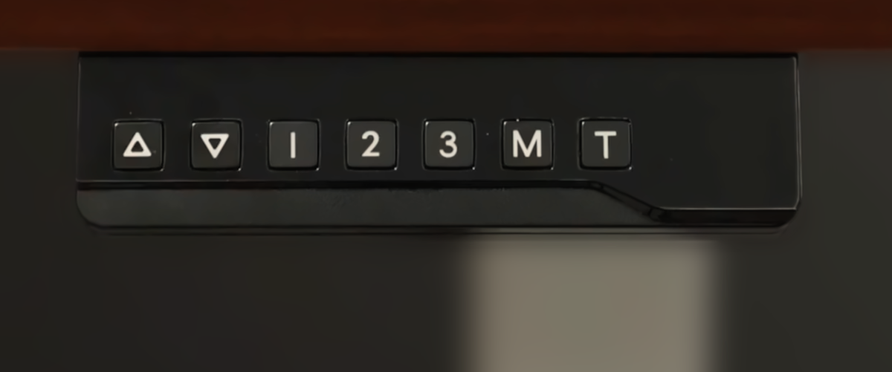

# T150 Desk Control for Deltaco Gaming DT410 / WT95

Add Wi-Fi control to a **Deltaco Gaming DT410 / GAM-140** standing desk with
ESPHome. Control it from a browser or Home Assistant, or use the independent
C++11 UART library in your own application.



Developed on one DT410, primarily with its panel in metric mode. The tested
unit has **T150-22-03-PJ** printed on the back of the controller enclosure,
**T150-PJ-V1.5** on the PCB and an
**STM32F030C8T6** MCU.

The controller identifies itself over UART as **LUMI LEGEND GROUP**, model
**T150-22-03**. This matches the enclosure's **T150-22-03-PJ** model number
without the `-PJ` suffix. ESPHome diagnostic entities expose the reported
model, manufacturer, additional identifiers and date string.
See [controller identity](docs/esphome.md#controller-identity) for the values
and their interpretation.

The **Deltaco Gaming WT95 / GAM-140-W** is the white variant of this desk;
**DT410 / GAM-140** is the black variant. They share an instruction manual
and matching published specifications.
See [desk and controller compatibility](docs/hardware.md#desk-and-controller-compatibility)
for model identification and supporting sources.

The **LUMI C150 touch panel** is a possible compatibility candidate: LUMI gives
it shared operating instructions and error codes with the T150. See the
[other T150 and C150 candidates](docs/hardware.md#untested-t150-and-c150-compatibility-candidates)
for model identifiers and sources.

## What it does

- Reads height and reports whether desk UART telemetry is fresh.
- Optionally exposes [raw load telemetry](docs/esphome.md#raw-load-telemetry).
- Displays height, targets and preset settings in manually selected cm or inches.
- Recalls three presets and edits their heights through Configuration entities.
- Accepts a target height using the default preset-3 backup/restoration path,
  or the DT02 direct firmware backend, with optional [automatic selection](docs/esphome.md#automatic-backend-selection).
- Sends a controlled Stop, with visible reasons when further control is blocked.
- Keeps an awake panel active through optional [idle keep-awake](docs/esphome.md#keep-awake).
- Offers experimental timer buttons and optional raw load-limit settings.

## Install

You need a compatible T150 controller, a Wi-Fi ESP32 board, three UART wires
and a separate USB power supply for the ESP32. Follow the TX/RX/GND connections
in [hardware](docs/hardware.md).

### Choose your ESP32

The component uses standard ESPHome UART and storage APIs; it does not require
M5Stack hardware. These full-control examples use the local repository checkout by default:

| Board | YAML | ESP32 TX / RX | Verification |
|---|---|---|---|
| M5Stack Stamp-C3, 4 MB | [stamp-c3.yaml](examples/esphome/stamp-c3.yaml) | GPIO4 / GPIO5 | Desk control tested on hardware |
| ESP32-WROOM-32 development board, 4 MB | [esp32.yaml](examples/esphome/esp32.yaml) | GPIO17 / GPIO16 | Configuration and firmware build only |

Other Wi-Fi ESP32 boards can use the same component. Adapt `esp32.variant`,
`flash_size`, `uart_tx_pin`, `uart_rx_pin` and `logger` to the board. The desk
needs one hardware UART at 115200 baud, 8N1, with 3.3 V TX/RX signals.
A successful build verifies software compatibility; the board's wiring and UART
operation still need a physical check. See [other ESP32 boards](docs/esphome.md#other-esp32-boards).

### ESPHome Device Builder

1. Create a device in Device Builder and replace its YAML with the example
   for your board above. Remove `#` from the `source: github://...` line under
   `external_components`; it overrides the local default.
2. Set `device_name` and `display_unit`. Copy the keys from
   [secrets.example.yaml](examples/esphome/secrets.example.yaml) into Device
   Builder's `secrets.yaml`, beside the device YAML. Fill in your Wi-Fi, API,
   OTA and browser-login details. Keep the generated API key from the
   device wizard, or generate one with `openssl rand -base64 32`.
3. Validate and install the firmware. Use USB for the first installation;
   subsequent updates can use Wi-Fi.
4. Open `http://<device_name>.local/` or the ESP32's IP address in a browser
   on the same network. Log in with `web_username` and `web_password`.
5. For Home Assistant, add the device through **Settings → Devices & services →
   Add integration → ESPHome**, using its address and API encryption key.

With the GitHub line enabled, ESPHome downloads the component and its
`lib/desk_protocol` headers without a manual clone on the Device Builder host.
Tested with ESPHome 2026.4.2.

### Without Home Assistant

Download your board's YAML and `secrets.example.yaml` into the same directory.
Rename the latter to `secrets.yaml`, fill in your settings and uncomment the
GitHub source line. Build and install with the [standalone ESPHome commands](docs/esphome.md#standalone-install).
Open the device address in a browser after installation.

The browser page shows height, target height, preset buttons and settings,
Stop, timers and controller status. The version-3 page groups controls into
Desk control, Presets, Timer, Load settings, Recovery and Diagnostics.
The optional reader adds its own Firmware group. Clicking a sensor opens its
history graph. Core interface files are stored on the ESP32, so it works on the
local Wi-Fi network without internet access; icon fonts load externally. Home Assistant is optional; both
interfaces use the same controls. Use the physical panel for
Up/Down jogging and to wake a sleeping panel.

### Local development checkout

Keep the YAML files in `examples/esphome/` inside the complete checkout. Their
`../../components` path is relative to that directory and points to the repo's
`components/`. `desk.yaml` enables monitoring; `stamp-c3.yaml` and `esp32.yaml`
enable full controls. Copy `examples/esphome/secrets.example.yaml` to
`examples/esphome/secrets.yaml`, fill in your settings, and follow
[local build and install](docs/esphome.md#local-build-and-install). For copied YAML
files, see [configuration paths](docs/esphome.md#configuration-paths).

Set `display_unit: cm` or `display_unit: in` under `desk_uart` to choose the
height, target and preset units. The panel's own unit setting is independent.
See [display units](docs/esphome.md#display-units) for conversion and range details.

Stop uses the desk's soft deceleration over UART. Load-limit values are raw
controller units. The target range is 73–118 cm and can be narrowed in the
configuration. See [operation and recovery](docs/esphome.md#stop-and-recovery)
for Stop behavior and interrupted preset handling.

## Use the C++ library elsewhere

Add the checkout's `lib/desk_protocol` directory with CMake and link the
`desk_protocol` interface target, or add its `lib/desk_protocol/include` directory
to your include path:

```cpp
#include <desk_protocol/protocol.h>

desk_protocol::Parser parser;
desk_protocol::Frame frame;
// Feed received bytes with a monotonic uint32_t millisecond clock.
// When parser.feed(byte, now, frame) returns ParseResult::FrameReady:
//   decode_height(frame, height), or dispatch another message type.
```

`height_profile.h` contains the shared height conversions and profile checks.
The caller supplies transport, timing and storage. `target.h`, `presets.h` and
`timer.h` add the target-height, preset-editing and timer transactions. See
[protocol](docs/protocol.md#headers) for each header's role, framing, parameter
selectors and the transaction state diagrams.

## Tests

Run these commands from the repository root, where `CMakeLists.txt` is located.
They require CMake and a C++11 compiler. Set TMPDIR to a writable temporary
directory first. These tests do not access hardware:

```sh
desk_build_dir=$(mktemp -d "${TMPDIR:?Set TMPDIR to a writable temporary directory}/t150-tests.XXXXXX")
cmake -S . -B "$desk_build_dir" -DDESK_SANITIZERS=ON -DCMAKE_BUILD_TYPE=Debug
cmake --build "$desk_build_dir"
ctest --test-dir "$desk_build_dir" --output-on-failure
```

[Supported features and testing](docs/validation.md) lists feature limits and
test coverage. The two small UART fixtures are protocol traffic, not firmware.

## Repository

Paths relative to the repository root:

```text
lib/desk_protocol/                portable header-only C++11 library
components/desk_uart/             ESPHome adapter
components/desk_firmware_export/  optional firmware reader
components/desk_firmware_update/  optional patch and recovery interface
examples/esphome/                 monitoring and ESP32 control configurations
tests/                            native tests and UART fixtures
tests/esphome/                    host/PTY integration tests
docs/                             wiring, setup, protocol and validation summary
```

Source is MIT licensed. Manufacturer firmware, dumps, decompiler exports,
deployment images, credentials and private research logs are not distributed.
The project is independent of Deltaco, the controller manufacturer and M5Stack.

## Firmware download

The optional [firmware export package](docs/firmware-export.md) reads the desk's
application into ESP32 RAM, using the header's file size up to 128 KiB when
memory permits. Standard ESPHome buttons control the read;
an authenticated HTTP route downloads the file. Recognized images also expose
firmware profile diagnostics. It requires a physical desk
power cycle while the ESP32 stays powered. The normal examples exclude it.
Use [stamp-c3-firmware-export.yaml](examples/esphome/stamp-c3-firmware-export.yaml)
only when the reader is needed.

Optional [firmware maintenance](docs/firmware-update.md) provides backup, DT02 or CL01 patch preparation, installation and complete application readback from the device web page.

The optional [panel lock](docs/child-lock.md) disables physical panel buttons and
retains the selected state through power loss. It requires CL01 firmware; remote
controls remain available, while locked panel buttons cannot stop remote movement.
