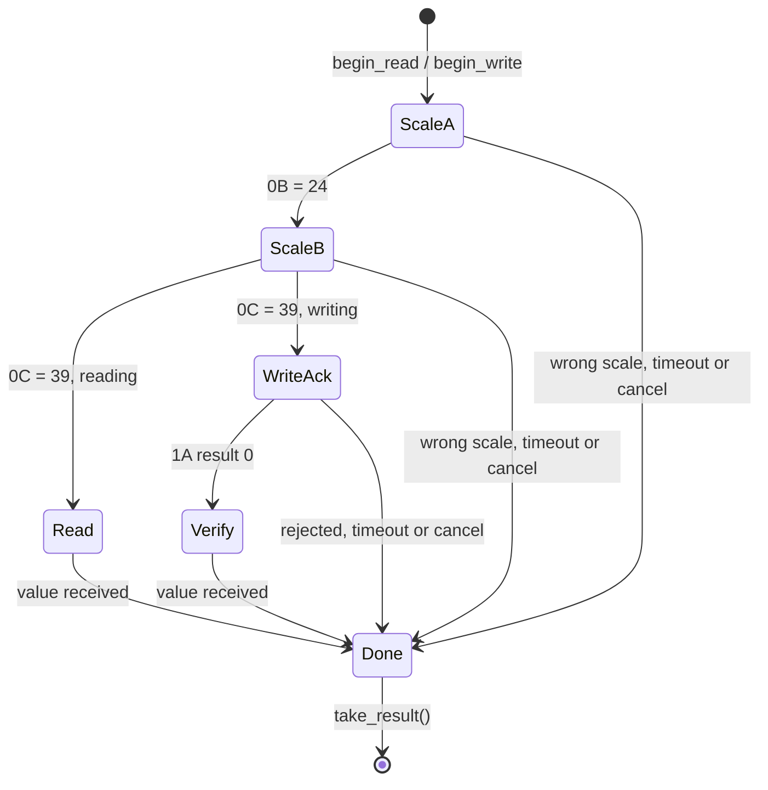
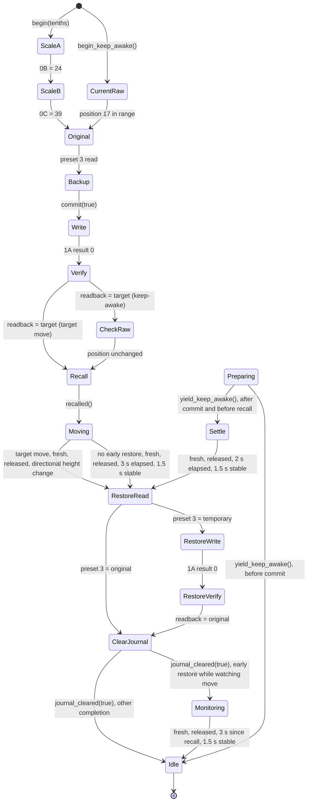
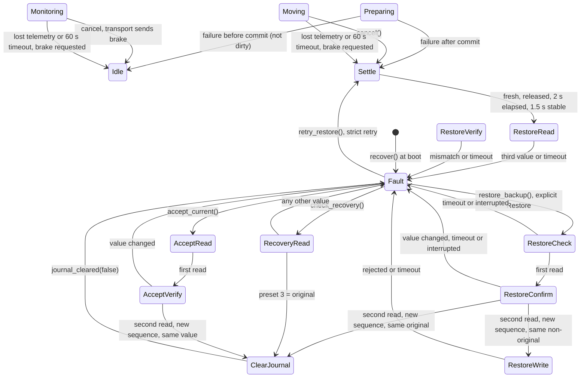
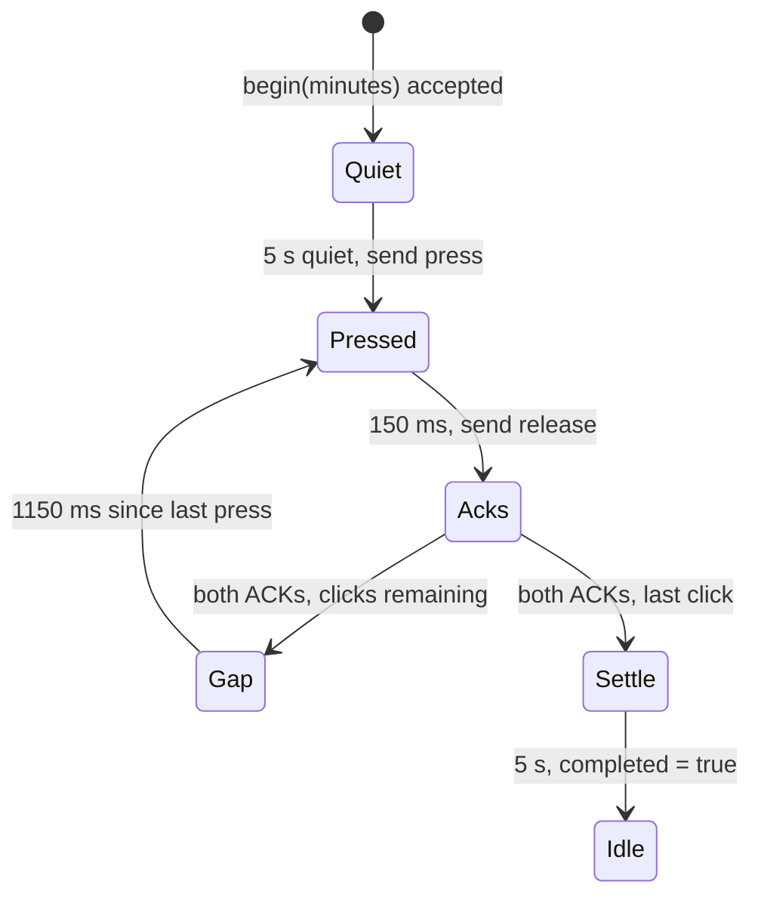
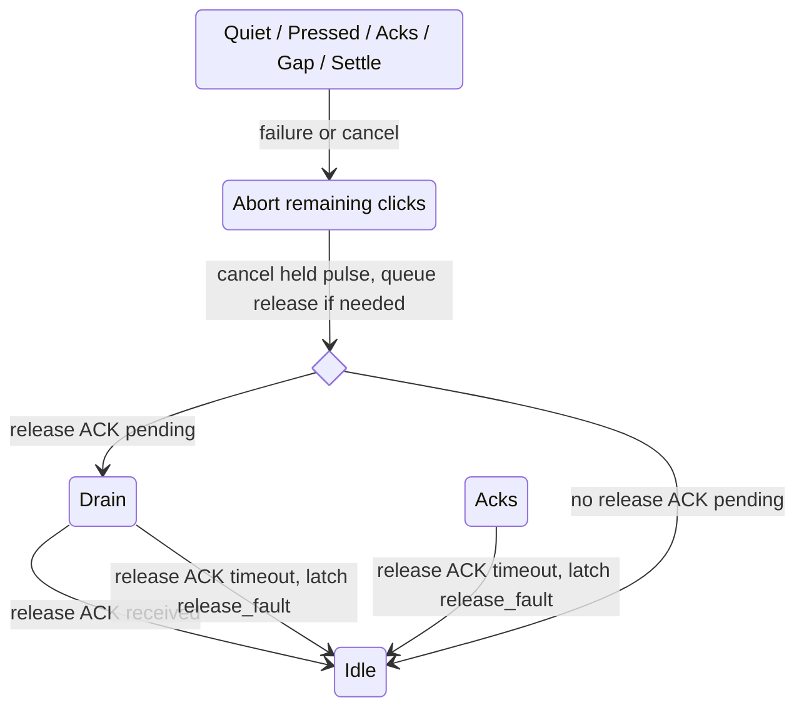

# Protocol library

`lib/desk_protocol` (version 0.1.0) is a header-only C++11 library. Include the
headers directly or use the CMake INTERFACE target. No heap allocation,
exceptions, RTTI, I/O or platform clock is required by the library itself.

Contents:

- [Headers](#headers)
- [Framing](#framing)
- [Known messages](#known-messages)
- [Controller identity](#controller-identity)
- [Parameter selectors](#parameter-selectors)
- [Controlled braking](#controlled-braking)
- [Load-limit builders](#load-limit-builders)
- [Coordinates and state](#coordinates-and-state)
- [Height profiles](#height-profiles)
- [Preset settings transaction](#preset-settings-transaction)
- [Temporary target transaction](#temporary-target-transaction)
- [T-key timer transaction](#t-key-timer-transaction)
- [Test fixtures](#test-fixtures)

## Headers

Each header includes the one it builds on, so including `presets.h` also makes
`target.h` and `protocol.h` available.

| Header | Depends on | Responsibility |
|---|---|---|
| `desk_protocol/height_profile.h` | standard headers only | Shared display/position conversions, mathematical profile checks and the existing T150 control policy |
| `desk_protocol/protocol.h` | `height_profile.h` | Framing (`encode`, `Parser`), command builders, typed decoders, `metric_display`, and the small helpers `HeightMonitor`, `AckTracker` and `ButtonPulse` |
| `desk_protocol/target.h` | `protocol.h` | Metric target conversion (`metric_target_raw`), typed parameter reads, and the `TemporaryPreset` transaction used for target height and keep-awake |
| `desk_protocol/presets.h` | `target.h` | Preset height conversion (`preset_height`), preset reads, and the `PresetSettings` read/write transaction |
| `desk_protocol/timer.h` | `protocol.h` | The `TimerSequence` T-key transaction |
| `desk_protocol/identity.h` | `protocol.h` | Bounded text-identity query builder and fixed-width ASCII decoder |

All transaction classes follow the same calling pattern. The caller drains
`take_frame()` and transmits the frame, feeds every received frame to
`accept()`, and calls `tick()` with its monotonic clock. None of them performs
I/O, stores data or retries a write or movement.

## Framing

`FA | kind + arguments + XOR | FD`. XOR covers the decoded kind and arguments.
Reserved body/checksum bytes FA, FD and FE are preceded by FE without otherwise
changing the byte. The parser accepts unknown kinds but typed decoders require
exact lengths.

`Frame` contains kind and arguments **without checksum or delimiters**. Its
maximum length is 64 bytes. `Packet` is an encoded wire buffer of at most 132 bytes.
This is an implementation limit, not a discovered maximum of the device protocol.
The bounded parser reports bad length, checksum and overflow. Unescaped FA
resynchronizes; an incomplete frame expires after 250 ms between bytes. Call
`expire(now)` when no bytes arrive if immediate timeout handling is needed.

Supply monotonic milliseconds as uint32. Timing comparisons use unsigned
subtraction and handle wraparound; call the helpers regularly, not after an
entire 49.7-day counter cycle without observations. The library is single-threaded;
serialize accesses from interrupt/task contexts in the transport adapter.

## Known messages

Message kinds, parameter selectors and wire bytes below are hexadecimal. Frame
lengths, button numbers and timing values are decimal unless marked otherwise.

| Purpose | Kind | Frame length, excluding XOR | Interpretation |
|---|---|---:|---|
| Query status | A1 | 1 | No arguments |
| Status response | A2 | 4 | coarse state, sequence BE16 |
| Schedule telemetry | 13 | 7 | channel, zero, period BE16, auxiliary zeros |
| Schedule acknowledgment | 14 | 6 | auxiliary echo, reserved byte, sequence |
| Height response on channel 2 | 05 | 32 | Q at offsets 19–20, sequence at 30–31 |
| Parameter read | 15 | 4 | selector, two zero bytes |
| Parameter value | 16 | 6 | selector, value BE16, sequence BE16 |
| Button override | 17 | 3 | selector, 1 pressed / 0 released |
| Controlled brake | 17 | 4 | selector 01, echo 00, action 00; own `stop()` builder |
| Button acknowledgment | 18 | 6 | selector, value, reserved byte, sequence |
| Parameter write | 19 | 4 | selector, value BE16 |
| Parameter acknowledgment | 1A | 5 | selector, result byte, sequence BE16; no extra reserved byte |

Builders expose telemetry channels 2 and 3. Period FFFF disables a channel;
period 0 is rejected. The ESPHome adapter uses only channel 2 at 500 ticks.
Channel 3 has additional controller state gates and peer requests. Use channel 2
for the supported adapter; other channels need further validation.
Button selectors are UP 3, DOWN 4, M 5, presets 1/2/3 at 6/7/8, T at 9.
Selector 1 is exposed only as the fixed four-byte `stop()` builder. Selector 2
and reset/save/bootloader commands remain absent. `button()` still rejects both.

Wire examples:

```text
FA A1 A1 FD                         status query
FA 13 02 00 01 F4 00 00 E4 FD       channel 2, period 500
FA 13 02 00 FF FF 00 00 11 FD       channel 2 off
FA 19 1F 00 08 0E FD                preset 3 raw value 8
FA 17 08 01 1E FD                   preset 3 press
FA 17 08 00 1F FD                   preset 3 release
FA 17 01 00 00 16 FD                direct controlled brake
```

## Parameter selectors

Parameters are read with kind 15 and written with kind 19. A read is answered
by a kind 16 value; a write is answered by a kind 1A acknowledgment whose result
byte is zero on acceptance. Only the selectors below are used by the library.

| Selector | Meaning | Access in the library | Builder or reader |
|---|---|---|---|
| 0B | Height scale coefficient A, expected 24 | Read only | `read_target_parameter`, `PresetSettings`, `TemporaryPreset` |
| 0C | Height scale coefficient B, expected 39 | Read only | as above |
| 0E | Upward load limit, raw units | Read and write | `read_load_limit`, `write_load_limit` with `LoadLimit::Upward` |
| 0F | Downward base load limit, raw units; also used for homing | Read and write | `LoadLimit::DownwardBase` |
| 10 | Alias of the 0F write target | Not exposed; rejected | — |
| 17 | Integer position counter | Read only; never write it | `read_target_parameter`, keep-awake in `TemporaryPreset` |
| 1D / 1E / 1F | Preset 1 / 2 / 3 raw position | Read and write | `read_preset_raw`, `write_preset_raw`; selector = 0x1C + slot |

Every transaction that maps centimetres to raw coordinates first reads 0B and
0C and stops if they are not 24 and 39. Raw preset and position values are
controller coordinates, not centimetres.

## Controlled braking

`desk_protocol::stop()` returns body `17 01 00 00`. Encode and transmit it using
the caller's transport. The final zero is required; this is not a simulated
button press/release. `AckTracker.begin(0x18, 1, 0, now)` can track its response.
ACK18 echoes the preceding zero, not the final action byte, and proves neither
that the state guard passed nor that the desk has stopped.

The command clears an internal gate and calls the soft-braking helper in the
normal movement state. It adjusts the target in the current direction rather
than cutting PWM. Repeated transmission can recalculate that target. Braking
also depends on the controller mode and pending button events. The portable builder has no latch or motion policy;
those belong to the caller. ESPHome adds a temporary stop interlock. It clears
after ACK, fresh settled height and preset cleanup; communication or restoration
faults remain blocked.

Stop requests controlled deceleration, not an emergency stop. The desk can
continue travelling while slowing down. No fixed stopping distance is assumed.

## Load-limit builders

`LoadLimit::Upward` selects 0x0E; `LoadLimit::DownwardBase` selects 0x0F.
`read_load_limit(limit, frame)` builds body `15 selector 00 00`.
`write_load_limit(limit, raw, frame)` builds `19 selector value-BE16`.
`decode_load_limit` accepts only exact six-byte kind 16 replies for these
selectors, returning the raw value and sequence. All lengths exclude XOR.
Unknown selectors and 0x10 are rejected. The latter aliases the downward write
target, not its read.

The portable helpers encode the full uint16 range and have no I/O or automatic
policy. The ESPHome number controls restrict user input to integers 1..65535,
read initial values first, and check writes by readback. Neither range is a
validated operating envelope. No automatic nonvolatile-save command is sent.

Normal downward protection compares load against `base+1200`; homing compares
against the same base. `downward_motion_cutoff(base)` returns a uint32 to avoid
16-bit overflow in that explanatory sum. It does not set an independent limit.

Downward adjustment remains experimental and needs hardware testing. See
[supported features and testing](validation.md).
Read replies carry no request ID, so late identical responses remain ambiguous.

## Coordinates and state

Q is not a centimetre target. `metric_display(Q)` implements the metric
display mapping: Q+725 in tenths of cm, with Q=4..7 mapped to 730 and Q=457..459
mapped to 1188. Values below 1000 retain one decimal; values at or above 1000
are truncated to whole centimetres. Both the pre-display value and actual
displayed tenths are returned. This function does not detect the panel's unit
mode. The ESPHome adapter can independently present inches via `display_unit`;
it divides the value before metric display truncation by 2.54 and converts
inch inputs back to cm before calling the existing target/preset helpers.

The current raw preset builder validates only slot 1..3 and wire width. The
controller may later autosave the modified slot. Apply the configured height
limits before converting a user input to a raw preset value.

Status 0 aliases multiple internal modes and does not prove stationary motion.
An ACK proves handler reception, not physical action, stopping, or persistence.
Parameter reply 1A is one byte shorter than 14/18. For example,
`FA 1A 1F 00 01 19 1D FD` carries a result byte and sequence without the extra
reserved byte used by 14/18.
`AckTracker` matches kind and echo fields for one outstanding request. Because
the outbound request carries no transaction ID, late identical ACKs cannot be
fully disambiguated. It does not retry commands. Poll `expired(now)` even when
unrelated or late frames are received.

`HeightMonitor` marks samples stale after 3000 ms. While fresh it rejects duplicate
and backwards sequence numbers so replays do not keep the link fresh. After
staleness it accepts a new epoch, allowing controller restarts.

## Height profiles

`HeightProfile::known_t150()` supplies the configured profile used by ESPHome,
`TemporaryPreset` and `PresetSettings`. The existing `metric_display`,
`metric_target_raw` and `preset_height` functions remain shorthand for it.
Channel-2 telemetry already contains Q; `display(Q)` applies only the display
mapping. Integer preset coordinates pass through `scaled_q(raw, q)` first,
using separate binary32 multiplication and division before truncation.

The built-in command policy retains heights 73–118 cm, target/preset coordinates
8..740 and keep-awake coordinates 6..740. Keep-awake preserves the exact raw
position. `target_raw()` keeps the existing deterministic selection, including
raw 8 at 73 cm. Requests for 73.1 and 73.2 cm still select raw 10 and 12, both
within the 73 cm display plateau.

Research profiles have three separate checks: the caller's extraction-supported
flag, `assess(boot_a, boot_b).mapping_usable`, and control approval. Assessment
requires known boot coefficients matching current coefficients; UART reads of
current A/B alone do not establish the boot values. It checks the integer
coordinate domain and monotonic display mapping. A research profile cannot
start target, keep-awake, preset-settings or recovery transactions, even when
its mathematical checks pass. Imported recovery backups remain in memory. The configured built-in profile does not identify
the firmware running on a connected controller.

`inverse_candidates()` returns every matching integer coordinate as a range and
count. It reports no candidates for gaps such as 73.1/73.2 cm. These candidates
precede the firmware's directional +7/-6 adjustments. `motion_target()` models
those adjustments for integer current positions. Actual position may be
fractional, so a truncated UART reading cannot predict the branch. The helper
does not change outgoing commands or predict physical stopping height.

The optional [firmware reader](firmware-export.md#firmware-profile-diagnostics)
uses `firmware_profile.h` to recognize the pinned application structure and
extract five scalar values. Its result can construct only a research profile;
it does not select the adapter's configured profile. Alternate YAML profiles
and physical acceptance of additional ranges remain separate work.

## Preset settings transaction

`desk_protocol/presets.h` reads and edits stored preset heights without
recalling a preset or moving the desk.

`read_preset_raw(slot, frame)` builds a parameter read for slot 1..3.
`preset_height(raw, tenths)` converts a stored raw value to tenths of a
centimetre using the same metric profile as `target.h`: raw 8..740 is scaled by
24/39 and passed through `metric_display()`. It returns the value before the
panel's whole-centimetre rounding, so a stored 104.6 cm is reported as 1046, not
1040. Values outside 73.0–118.0 cm are rejected.

`PresetSettings` runs one read or one write at a time:

- `begin_read(slot, now)` reads scale A and B, then the preset.
- `begin_write(slot, tenths, now)` converts the height with
  `metric_target_raw()`, reads scale A and B, writes the preset once, waits for
  its 1A acknowledgment and reads the value back.



Each step has a 700 ms timeout. `take_result()` returns the slot, whether it
was a write, success, whether a value is known, the raw value and an error text,
and returns the transaction to idle. A readback mismatch is reported as an error
but still carries the actual value, so the caller can show what the controller
holds. Timeout or `cancel()` does not undo a write that was already transmitted,
and no EEPROM-save command is sent. The controller can still autosave the edit.

## Temporary target transaction

`desk_protocol/target.h` adds the platform-independent `TemporaryPreset` state
machine, typed reads for selectors 0B/0C/17/1F, and bounded metric target conversion.
`metric_target_raw()` uses A=24, B=39 and bounds 73.0–118.0 cm. Raw 8 is the
calibrated 73.0 reference; otherwise the candidate is ceil((10*cm-725)*39/24).
The controller applies its direction-dependent recall correction internally.

The caller drains `take_frame()`, feeds replies through `accept()`, and supplies
its monotonic clock, fresh/deduplicated telemetry and raw-Q stability to `tick()`.
`Backup` requires durable storage before `commit(true)`. `Recall` requires a
separate bounded preset pulse and `recalled()`. `take_brake()` requests the
transport's priority stop path. `ClearJournal` hands completion to the caller's
storage policy. ESPHome retains the backup after RAM restoration or a matching
recovery read; only explicit acceptance clears it durably.
`recover()` reinstates a pending record without sending anything; explicit
`restore_backup()` requests explicit restoration, never motion. It requires two
stable reads with different receive sequences before replacing a non-original
value. The adapter uses this method for its Restore button. `retry_restore()`
retains the strict automatic-restoration path, which refuses a third value.
`check_recovery()` reads without overwriting an ambiguous value. `accept_current()` reads preset 3 twice
with different receive sequences; matching values allow the caller to clear the
backup without writing to the controller. Lost telemetry, unstable height or
interruption retain the backup. Cancellation drops any unsent target frame.
There are no automatic write or movement retries.

The normal path of a target move and of a keep-awake cycle:



Failures and recovery. Before `commit(true)` nothing has been written, so a
failure returns to idle. After it, the transaction is *dirty*: a failure during
preparation or movement goes to `Settle` and then restores the original, while a
failure during restoration or inspection goes to `Fault` and keeps the backup.



After early restoration, `Monitoring` is busy but no longer dirty: the original
preset has been read back and the RAM transaction has completed. The adapter
retains its persistent backup. A Stop still goes through
the transport's braking/settling interlock. Lost telemetry or the 60 s movement
timeout requests a brake and ends monitoring with an error. Failure while early
restoration is in progress, including storage-handshake failure, also requests a
brake; the backup remains available for recovery. Keep-awake never
uses the early-restoration path. Stability is a heuristic, not proof of reaching
the requested height.

`Preparing` groups the phases before the button is sent, from
`ScaleA`/`CurrentRaw` through `Backup`, `Write`, `Verify`, `CheckRaw` and `Recall`. Each phase that waits for a reply has a 700 ms timeout. Recovery
inspection also fails back to `Fault` if telemetry becomes stale, height is not
stable for 1.5 s, or a button release is outstanding.

`interrupted_by_change()` records whether this cycle encountered a caller-reported
height change or late sample (`abort_keep_awake()`) or a raw-position change
before recall. It stays true during cleanup, including if restoration later
fails. It therefore does not mean that the current error is recoverable: check
the subsequent error and restoration outcome separately. A timeout, mismatch or
rejection alone does not set this flag. `abort_keep_awake(now, brake)` requests a
brake only when the caller says so; the adapter passes whether the preset press
has been sent.

`yield_keep_awake()` cancels a healthy automatic cycle before recall without
marking it failed. A dirty preset goes through `Settle` and verified restoration;
an already-sent recall or restoration finishes normally. The adapter owns the
waiting user button and its cancellation deadline.

The library has no storage backend. ESPHome owns journal persistence, UART,
buttons, publication and interlocks. See the adapter documentation for its
settling heuristic, autosave limitations and recovery workflow.

## T-key timer transaction

`desk_protocol/timer.h` adds `TimerSequence`, using only the existing selector 9
button frames. `begin(minutes, now)` accepts 30/60/90/120 and zero for cancel.
After a 5000 ms quiet interval it sends one to four 150 ms clicks, or five for
cancellation, with at least 1150 ms between press starts. It requires matching
press and release ACKs for each click. A final 5000 ms settling interval allows
the selection menu to commit. Call `poll_release()` before processing
RX, `accept()` for incoming frames, `tick()` with fresh/stable height, and drain
`take_frame()` immediately. The caller must serialize all other button/parameter
transactions. `cancel()` aborts the ESP sequence and can queue a release; it is
different from `begin(0, now)`, which requests cancellation of the desk timer.

Normal completion:



Failure and cancellation:



`Active`, `Abort` and the choice node describe failure handling, not additional
enum phases. Failure clears `completed()`. A return to `Idle` after failure does
not mean that the requested timer was set or cancelled.

A failure is a height change, stale telemetry, an ACK timeout, a delayed
release, `cancel()`, or a gap of 2000 ms before the next press. It aborts the
remaining clicks without replay and queues a release if a press is held. The
sequence goes through `Drain` only while that release ACK is outstanding;
otherwise it returns to idle directly.

A release ACK timeout or a hold lasting at least 500 ms latches `release_fault()`
for the caller's remote-button interlock, even if the eventual release is
acknowledged. The fault remains set after returning to `Idle`, and `begin()`
rejects further timer requests on that instance.
`completed()` means the software sequence finished, not that the alarm state was
verified. No timer-state query, direct sound command or immediate cancel frame
is established. Physical local clicks remain invisible and can invalidate the
sequence. The ESP-driven timer sequence is experimental and still needs
hardware testing. See [supported features and testing](validation.md).

## Test fixtures

`tests/fixtures/manifest.json` records the exact source and SHA256 of two small
unaltered UART RX captures. The 120-second capture has 239 height frames plus
two ACKs. The preset capture has 15 height frames and 6 other responses. Tests
replay them across every possible two-chunk split, including escaped values.
Synthetic cases cover malformed streams, maximum frames, unsigned time/sequence
wrap, stale data, ACK timeout and delayed release generation.

See [supported features and testing](validation.md) for integration-test coverage
and hardware limitations.

## Controller identity

`read_identity(selector, frame)` builds the four-byte request body
`11 selector 00 00` for verified text selectors 03, 04, 05, 06, 07 and 09.
`decode_identity(frame, value)` accepts `12 selector data sequence_be16`
with the selector's exact field width, printable ASCII and trailing NUL padding.
It returns a NUL-terminated string and the sequence number. It rejects counter
selector 08, unknown selectors, empty fields, embedded NULs followed by text,
non-ASCII values and wrong lengths. Output is unchanged when decoding fails.

| Selector | Data bytes | Observed content |
|---|---:|---|
| 03 | 16 | `T150-22-03` and six NUL bytes |
| 04 | 17 | `LUMI LEGEND GROUP` |
| 05 | 5 | `1.5.0` |
| 06 | 5 | `1.6` and two NUL bytes |
| 07 | 8 | `1.9.0118` |
| 09 | 8 | `21/01/18` |

These replies were captured from the tested controller on 2026-10-27, including
XOR and sequence validation. `tests/identity_test.cpp` retains the exact received
wire frames, including an escaped FA sequence byte. See
[controller identity interpretation](esphome.md#controller-identity) for the
model-label correspondence and unresolved identifier/date meanings.

The ESPHome component requests only configured text entities, one request per
second while idle, at most three attempts per field per ESP32 boot. It accepts
a reply only for its current selector within 700 ms. Identity reads do not
block user controls, reset link freshness, acknowledge motion commands, write
presets or keep the controller awake.
